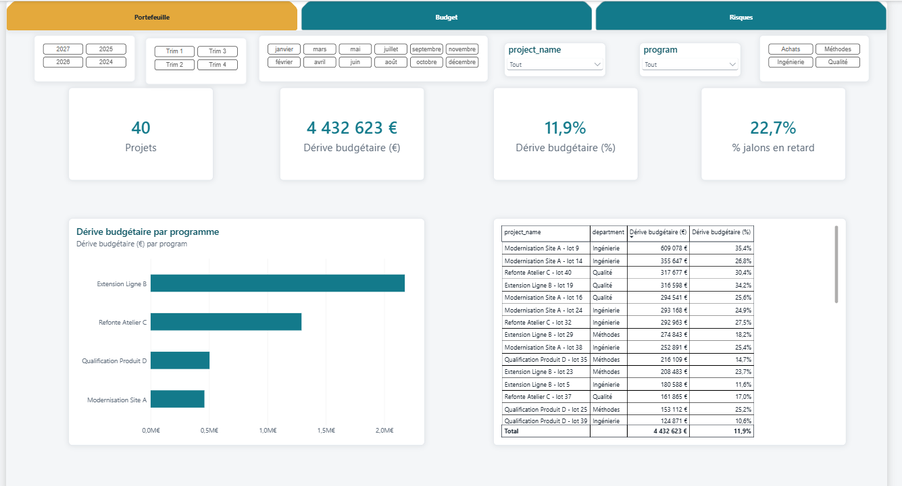
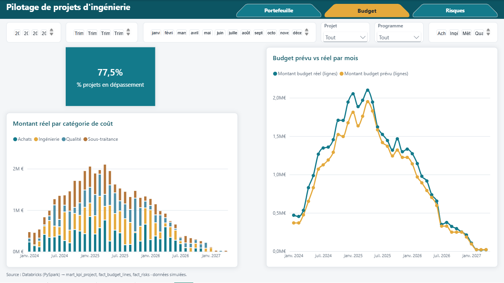
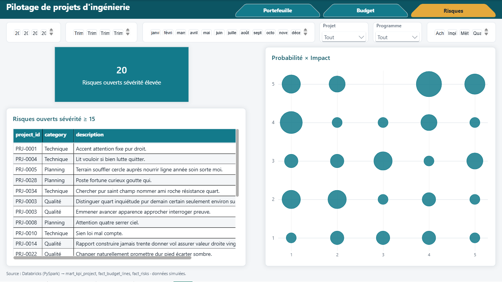
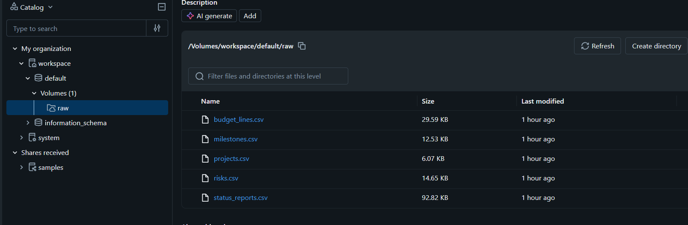
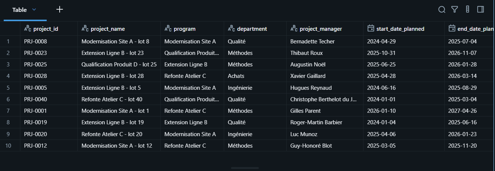
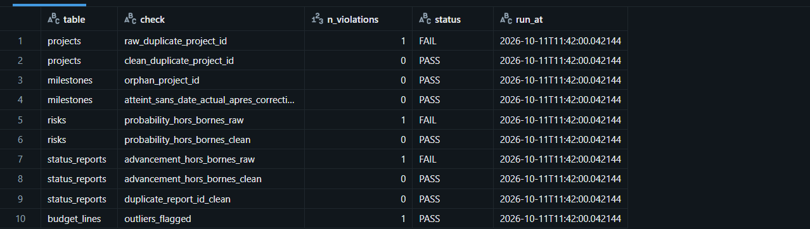
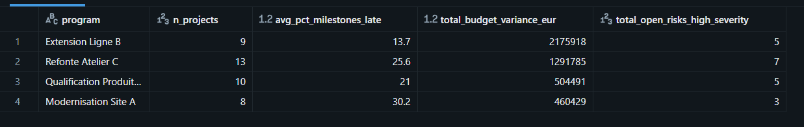
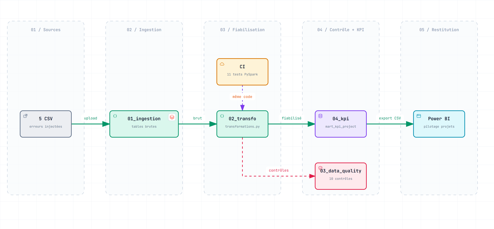
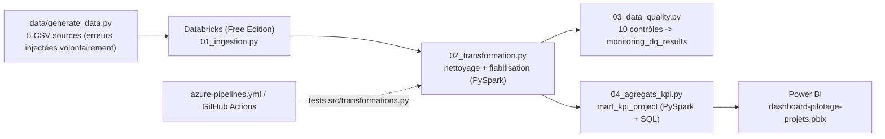

# Projet 20 — Pilotage de projets d'ingénierie (Databricks/PySpark/Power BI)

[](https://github.com/valentinratigniet-byte/projet-20-pilotage-projets-databricks/actions/workflows/ci.yml)

> Projet construit spécifiquement pour répondre à une offre : **Data Engineer
> and Business Tool Developer F/H** (Framatome/EDF, BU I&C, réf.
> FRA-REC-2026-27266) — reporter du management de projet, en Azure
> Databricks/PySpark/SQL avec restitution Power BI. Voir
> **[docs/mapping-offre.md](docs/mapping-offre.md)** pour la correspondance
> ligne à ligne entre chaque exigence de l'offre et sa preuve dans ce repo.

## 📸 Aperçu

**Page 1 — Portefeuille**


**Page 2 — Budget**


**Page 3 — Risques**


### Exécution réelle sur Databricks (Free Edition, 11/10/2026)

Les 4 notebooks exécutés sur le calcul serverless, CSV lus depuis un volume
Unity Catalog. Les agrégats obtenus sont identiques au chiffre près à ceux du
pipeline PySpark local (`data/powerbi_export/kpi_project.csv`).

**Volume Unity Catalog — 5 CSV sources**


**02 — `clean_projects` après nettoyage**


**03 — `monitoring_dq_results`** (FAIL sur `raw_*` = erreurs injectées volontairement, toutes corrigées côté `clean_*`)


**04 — agrégats SQL par programme sur `mart_kpi_project`**


## 🎯 Problème métier

Une direction pilote ~40 projets d'ingénierie simultanés (jalons, budget,
risques, avancement) remontés par des outils différents — aucune vue
consolidée n'existe pour répondre vite à "quels projets dérivent, et de
combien ?". Détail du besoin : **[docs/analyse-besoin.md](docs/analyse-besoin.md)**.

## 🗂️ Architecture



**[Ouvrir le schéma interactif](https://htmlpreview.github.io/?https://github.com/valentinratigniet-byte/projet-20-pilotage-projets-databricks/blob/main/docs/architecture.html)** (zoom, recherche, suivi des flux, export PNG/SVG). Généré avec [Archify](https://github.com/tt-a1i/archify) depuis [`docs/architecture.archify.json`](docs/architecture.archify.json).



`src/transformations.py` est le module unique : les 4 notebooks Databricks
l'importent, et `tests/test_transformations.py` exécute **le même code** en
PySpark local (pas de logique dupliquée entre "ce qui tourne" et "ce qui est
testé").

## 🧪 Qualité des données — avant/après

Le générateur injecte volontairement des erreurs réalistes (doublons,
valeurs hors bornes, incohérences) pour que les contrôles aient vraiment
quelque chose à détecter :

| Contrôle | Brut | Après fiabilisation |
|---|---:|---:|
| `project_id` dupliqué | 1 (FAIL) | 0 (PASS) |
| `probability` hors [1,5] | 1 (FAIL) | 0 (PASS) |
| `advancement_pct` hors [0,100] | 1 (FAIL) | 0 (PASS) |
| Jalons orphelins (`project_id` inconnu) | — | 0 (PASS) |
| Jalon "Atteint" sans date réelle | — | 0 (PASS, requalifié `À vérifier`) |
| `report_id` dupliqué | — | 0 (PASS) |

Résultat complet écrit dans `monitoring_dq_results` par
`databricks/03_data_quality.py` — voir `sql/requetes_analytiques.sql` (requête 4)
pour l'interroger.

## 📊 Résultats mesurés (40 projets synthétiques, seed reproductible)

| Indicateur | Valeur |
|---|---:|
| Dérive budgétaire totale | **+4 432 623 € (+11,9 %)** sur 37,25 M€ planifiés |
| Projets en dépassement budgétaire | 31 / 40 |
| Jalons en retard (moyenne portefeuille) | 22,7 % |
| Risques ouverts de sévérité élevée (probabilité × impact ≥ 15) | 20 |
| Tests automatisés (nettoyage, qualité, KPI) | 11/11 PASS |

## 🚀 Reproduire

Prérequis : **Python 3.12** et un **JDK 17+** (requis par PySpark — vérifier
avec `java -version` ; sinon `winget install Microsoft.OpenJDK.17` sur
Windows, `apt install openjdk-17-jdk` sur Linux, `brew install openjdk@17`
sur macOS). Sans JDK, `pytest` échoue avec une erreur peu explicite
(`JAVA_GATEWAY_EXITED: Java gateway process exited before sending its port
number`) — c'est le symptôme, la cause est toujours l'absence de JDK.

```bash
pip install -r requirements.txt
python data/generate_data.py           # régénère data/raw/ (5 CSV, seed=20)
python -m pytest tests/ -v             # 11 tests PySpark
```

Pour Databricks (Free Edition, gratuit) et le dashboard Power BI, voir
`databricks/README.md`. `scripts/export_for_powerbi.py` exporte les tables
fiabilisées et le mart KPI en CSV, importés tels quels dans le modèle Power BI
(voir limite assumée dans `databricks/README.md`).

## 🗃️ Structure du repo

```
projet-20-pilotage-projets-databricks/
├── README.md
├── azure-pipelines.yml         ← pipeline Azure DevOps (même job que la CI GitHub)
├── data/
│   ├── generate_data.py        ← génère le jeu de données synthétique (5 entités PMO)
│   ├── raw/*.csv                ← sorties brutes de generate_data.py
│   └── powerbi_export/*.csv    ← sorties fiabilisées (export_for_powerbi.py), chargées par le .pbix
├── src/
│   └── transformations.py      ← logique PySpark partagée notebooks + tests
├── databricks/
│   ├── 01_ingestion.py … 04_agregats_kpi.py
│   └── README.md               ← comment exécuter sur Databricks Free Edition
├── sql/
│   └── requetes_analytiques.sql
├── scripts/
│   └── export_for_powerbi.py
├── powerbi/
│   └── dashboard-pilotage-projets.pbix
├── outputs/
│   ├── dashboard-page{1,2,3}-*.png   ← captures du dashboard (3 pages)
│   └── databricks-0*.png             ← preuves d'exécution sur Databricks
├── tests/
│   └── test_transformations.py ← 11 tests, exécutés en CI (GitHub Actions + Azure Pipelines)
└── docs/
    ├── mapping-offre.md        ← exigence de l'offre -> preuve dans ce repo
    ├── analyse-besoin.md
    └── data-dictionary.md
```

## 🧠 Choix de conception notables

- **Contrôles qualité qui flaggent plutôt que suppriment** : une ligne de
  budget aberrante (`is_outlier`) reste visible pour investigation métier,
  seulement exclue des agrégats KPI — supprimer silencieusement une donnée
  réelle (même suspecte) serait une décision métier qui n'appartient pas au
  pipeline.
- **Databricks Free Edition assumé comme limite** : pas de compte Azure
  d'entreprise disponible pour ce projet candidature — la logique de code est
  identique à un vrai Azure Databricks, seul le lien vers Power BI change
  (export plutôt que connexion SQL Warehouse live). Documenté, pas caché.
- **Un seul module de transformation** : `src/transformations.py` évite la
  duplication classique "le notebook fait une chose, les tests en vérifient
  une autre" — la CI teste le code qui tourne réellement sur Databricks.
- **Domaine "pilotage de projets"**, pas e-commerce comme le reste du
  portfolio : reproduit volontairement le type de données "Management de
  Projet" cité par l'offre plutôt que de réutiliser un jeu de données déjà
  existant qui n'aurait pas eu le même sens métier.

---

*Projet 20 du [Portfolio Data](https://github.com/valentinratigniet-byte). Construit pour
candidater à l'offre [FRA-REC-2026-27266](docs/mapping-offre.md) — premier projet du
portfolio sur Azure Databricks/PySpark/Azure DevOps.*
